# Bomberman Land 3 — tradução

Ferramentas para traduzir o **Bomberman Land 3** (PlayStation 2, Japão, SLPM-62643) para outros idiomas.
O repositório tem a engenharia reversa do jogo e um pipeline completo: extrai o texto, você traduz
numa planilha, e as ferramentas geram um ISO jogável com o texto novo, fontes com acentos incluídas.

> O jogo **não** está incluído. Você precisa da sua própria cópia do disco (`.bin` + `.cue`).
> Nunca faça commit de arquivos do jogo (`.bin`, `.iso`, `.DIG`); o `.gitignore` já bloqueia.

## Sumário

- [Como funciona](#como-funciona)
- [Requisitos](#requisitos)
- [1. Preparar o disco](#1-preparar-o-disco)
- [2. Traduzir](#2-traduzir)
- [3. Gerar o ISO traduzido](#3-gerar-o-iso-traduzido)
- [4. Conferir](#4-conferir)
- [5. Jogar](#5-jogar)
- [Acompanhar o progresso](#acompanhar-o-progresso)
- [Trabalhando em equipe](#trabalhando-em-equipe)
- [Limitações conhecidas](#limitações-conhecidas)
- [Estrutura do repositório](#estrutura-do-repositório)

## Como funciona

O texto dos diálogos fica dentro de seis arquivos compactados do disco (`CDDATA*.DIG`). Cada cena tem
a sua **própria fonte**, com só as letras que aquele texto usa, e o texto é guardado como "letra nº 37,
letra nº 12…" dessa fonte, não como caracteres. Por isso traduzir não é só trocar texto: para cada
cena tocada é preciso redesenhar a fonte com as letras novas (á, ç, ñ, ł…).

```mermaid
flowchart LR
    BIN[".bin do jogo"] -->|bin2iso| ISO["game.iso"]
    ISO -->|7z| FILES["arquivos do disco"]
    FILES -->|dig_extract| DIG["cenas extraídas"]
    DIG -->|textscan| TSV["dialogos_jp.tsv"]
    TSV -->|você traduz| TR["traduzido.tsv"]
    TR -->|encode| OUT["Bomberman Land 3 (pt).iso"]
    OUT -->|verify| OK["conferido"]
```



O `encode.py`, para cada fonte afetada pela tradução:

1. mantém as letras que ainda são usadas e desenha as novas nos espaços que sobraram (ou acrescenta no fim);
2. regrava a textura da fonte no formato do PS2 (4 ou 8 bits por pixel, com a paleta original);
3. recodifica as tabelas de texto (o que não foi traduzido fica idêntico ao original);
4. recompacta as cenas alteradas e grava um ISO novo.

O jogo acha os `.DIG` pelo nome no diretório do disco, então o `.DIG` modificado vai para o fim do ISO
e só a entrada do diretório é corrigida. O resto do disco fica byte a byte igual ao original.

Os detalhes técnicos (formatos, endereços no executável, algoritmo de compressão) estão em [NOTAS.md](NOTAS.md).

## Requisitos

- Python 3.10 ou mais novo
- `7z` (p7zip) para abrir o ISO
- As fontes **Noto Sans** e **Noto Sans CJK** (no Debian/Ubuntu: `sudo apt install fonts-noto-core fonts-noto-cjk`); no Windows, veja abaixo
- [PCSX2](https://pcsx2.net) para jogar e testar
- Uma cópia do jogo: `Bomberman Land 3 (Japan).bin` e `.cue`

```bash
python3 -m venv .venv
.venv/bin/pip install -r requirements.txt
```

### No Windows

Funciona no PowerShell, sem WSL. Diferenças:

- Python do [python.org](https://www.python.org) ou da Microsoft Store; use `py` no lugar de `python3`.
- [7-Zip](https://www.7-zip.org) instalado; o `7z.exe` fica em `C:\Program Files\7-Zip\` (ponha no PATH ou
  chame pelo caminho completo).
- Fontes: sem o Noto instalado, o `encode.py` usa a **Arial Bold** e a **Yu Gothic Bold** do Windows. Para
  ficar igual ao Linux, instale o Noto Sans e o Noto Sans CJK (clique com o botão direito → *Instalar*); o
  `encode.py` acha sozinho. Ele mostra no início do log quais fontes usou.
- Os comandos deste README em PowerShell:

```powershell
py -m venv .venv
.venv\Scripts\python -m pip install -r requirements.txt
.venv\Scripts\python tools\bin2iso.py "Bomberman Land 3 (Japan).bin" game.iso
& "C:\Program Files\7-Zip\7z.exe" x game.iso -oiso
foreach ($d in 'CDDATA','CDDATA0','CDDATA1','CDDATA2','CDDATA4','CDDATA5') {
  .venv\Scripts\python tools\dig_extract.py iso\$d.DIG dig\$d
}
.venv\Scripts\python tools\encode.py dig iso game.iso traduzido.tsv saida --lang pt
.venv\Scripts\python tools\verify.py dig game.iso "saida\Bomberman Land 3 (pt).iso" traduzido.tsv --lang pt
```

Se mover ou renomear a pasta do projeto, apague o `.venv` e crie de novo: ele guarda o caminho antigo. E não
reaproveite no Windows um `.venv` criado no Linux/WSL (nem o contrário).

## 1. Preparar o disco

O disco vem como BIN/CUE (setores de 2352 bytes). As ferramentas trabalham com ISO comum (2048 bytes por
setor), que é o que o PCSX2 abre direto:

```bash
python3 tools/bin2iso.py "Bomberman Land 3 (Japan).bin" game.iso
7z x game.iso -oiso
for d in CDDATA CDDATA0 CDDATA1 CDDATA2 CDDATA4 CDDATA5; do
  python3 tools/dig_extract.py iso/$d.DIG dig/$d
done
```

Isso cria `iso/` (os arquivos do disco) e `dig/` (as cenas descompactadas, cerca de 1,6 GB). Só precisa
ser feito uma vez. O `dialogos_jp.tsv` do repositório já foi gerado a partir daí; para gerar de novo:

```bash
python3 tools/textscan.py dig iso/SLPM_626.43 iso/MSG.MGC dialogos_jp.tsv
```

## 2. Traduzir

Abra o `dialogos_jp.tsv` numa planilha (LibreOffice Calc, Google Sheets) **como texto separado por
tabulação, UTF-8**. Cada linha é uma string do jogo. Acrescente **uma coluna por idioma**, com o código
do idioma no cabeçalho: `pt`, `es`, `en`, `fr`, `pl`…

| Coluna | O que é |
|---|---|
| `archive`, `entry`, `file`, `id` | onde a string está no disco (cena, tabela, posição) |
| `string_res`, `font_res` | identificadores internos da tabela e da fonte |
| `method`, `margin` | como a fonte foi identificada (`elf` = certeza; `local`/`lm` = estimativa) |
| `text` | o texto original em japonês |
| `pt`, `es`, … | **a sua tradução**; célula vazia mantém o original |

### Códigos especiais

Os códigos entre chaves controlam a caixa de texto. Mantenha-os na tradução, no lugar equivalente:

| Código | Efeito |
|---|---|
| `\n` | quebra de linha |
| `{PAG}` | espera o botão e abre uma página nova na caixa de texto |
| `{NOME}` | nome que o jogador deu ao Bomberman |
| `{VAR}`, `{VAR2}` | número ou nome inserido pelo jogo (item, quantidade…) |
| `{COR:vermelho}`, `{COR:azul}`, `{COR:verde}`, `{COR:rosa}`, … `{COR}` | muda a cor; `{COR}` volta ao normal |
| `{CONTORNO}` … `{CONTORNO:off}` | contorno em volta das letras (destaque) |
| `{TAM:1.5}`, `{TAM:2}`, `{TAM:0.8}`, … `{TAM:1}` | tamanho da letra; `{TAM:1}` volta ao normal |
| `{ONDA}` … `{ONDA:off}` | texto ondulado |
| `{ESP:1/4}`, `{ESP:1/2}`, `{ESP:1}` | espaço extra |

Um destaque no original costuma ser `{CONTORNO}{COR:vermelho}palavra{COR}{CONTORNO:off}`: copie o padrão.

### Dicas

- **Quebre as linhas à mão.** O português e o espanhol ocupam mais espaço que o japonês. Use o original
  como referência de quantas linhas cabem por página e use `{PAG}` para dividir.
- **Qualquer letra latina, grega ou cirílica** funciona (á, ñ, ß, ł, ğ, ș, Ω, Ж…).
- **Mantenha nomes consistentes** (personagens, lugares, itens): a mesma lista de itens aparece em várias cenas.
- Salve sempre como **TSV UTF-8**. Planilhas às vezes trocam aspas ou convertem números; confira antes de gerar.

## 3. Gerar o ISO traduzido

```bash
python3 tools/encode.py dig iso game.iso traduzido.tsv saida/ --lang pt
```

Gera `saida/Bomberman Land 3 (pt).iso`, os `.DIG` novos e um `encode.log`. Troque `--lang` para gerar
outro idioma a partir da mesma planilha. Opções:

| Opção | Efeito |
|---|---|
| `--lang XX` | coluna do TSV a usar (padrão `pt`) |
| `--ttf FONTE` | fonte para desenhar as letras novas; repita para montar uma ordem de preferência |
| `--no-reuse` | só acrescenta letras novas, sem reaproveitar espaços livres da fonte |

Leia os avisos do log:

- `AVISO: fonte cresceu de N para M páginas` ou `AVISO: … cresceu X -> Y bytes`: a cena ficou maior que a
  original. Normalmente funciona, mas é o primeiro lugar a olhar se o jogo travar naquela cena.
- `PULADA: …`: aquela fonte não foi reconstruída (por exemplo, uma letra que nenhuma fonte TTF tem). O
  motivo vem na mensagem e as tabelas afetadas aparecem no fim do log.

## 4. Conferir

```bash
python3 tools/verify.py dig game.iso "saida/Bomberman Land 3 (pt).iso" traduzido.tsv --lang pt
```

Lê o ISO novo do mesmo jeito que o jogo lê e confere:

- toda string das cenas tocadas decodifica exatamente como está na planilha (traduzida ou original);
- cada fonte reconstruída tem uma textura válida;
- só dois setores do disco original mudaram (o descritor do volume e o diretório raiz).

Sai com código 0 se estiver tudo certo e 1 se algo não bater.

## 5. Jogar

Abra o ISO gerado no **PCSX2** (Arquivo → Executar ISO). Não é preciso voltar para BIN/CUE: o PCSX2 lê
o ISO de 2048 bytes direto.

O ISO gerado tem cerca de 150 MB a mais que o original, porque o `.DIG` antigo continua no disco como
espaço morto. Isso não importa no emulador, mas ultrapassa a capacidade de um CD de 700 MB.

## Acompanhar o progresso

```bash
python3 tools/progress.py traduzido.tsv --json progresso.json --langs pt,es,en
```

Mostra quanto de cada idioma está traduzido, no total e por cena. As tabelas repetidas entre cenas
contam uma vez só (são cerca de 8.200 strings únicas). `--langs` inclui idiomas planejados que ainda
não têm coluna (aparecem com 0%). O JSON tem só contagens, sem texto do jogo.

### Site da equipe: [games.gabirel.dev](https://games.gabirel.dev)

O **Glifo** (código em `web/`) é onde a equipe traduz pelo navegador:

- login com GitHub; vários jogos; idiomas com porcentagem de traduzido e revisado;
- papéis por jogo e por idioma (coordenação, tradutor, revisor), conferidos no servidor;
- editor por bloco com o original e os códigos destacados, histórico de cada string, revisão e
  atualização ao vivo quando outra pessoa salva;
- pedido para entrar na equipe e painel de administração;
- a coordenação importa o `dialogos_jp.tsv` e exporta o TSV com uma coluna por idioma para o `encode.py`;
- tradução automática com o Gemini (veja abaixo);
- interface em português, inglês, espanhol e japonês (detecta o navegador, troca no topo da página;
  textos em `web/public/i18n.js` e mensagens do servidor em `web/messages.js`).

O texto original só aparece para quem faz parte da equipe do jogo.

#### Tradução automática (Gemini)

A coordenação cola a chave da API do Gemini ([aistudio.google.com/apikey](https://aistudio.google.com/apikey))
em **Configurações → Tradução automática**, junto com as instruções (tom, glossário, nomes fixos). Depois:

- **Configurações → Traduzir vazias**: traduz as strings vazias de um idioma, com um máximo por rodada
  (comece com umas 50 para testar as instruções);
- **no editor, "Traduzir vazias com Gemini"**: traduz só as vazias daquele bloco.

As frases vão em lotes, na ordem do jogo. As regras dos códigos `{…}` e do `\n` vão sempre junto
(`web/ai.js`), e uma resposta com códigos diferentes do original (fora `{PAG}` e `\n`) é descartada; o motivo
aparece no painel. O que passa é salvo como **Gemini**, com status *traduzida*: aparece em "Para revisar"
e só entra no export de revisadas depois que um revisor aprova. Nunca sobrescreve uma string já traduzida,
e frases repetidas são traduzidas uma vez e preenchem as cópias.

A chave fica guardada no banco (tabela `game_ai`) e nunca volta para o navegador. Só a coordenação vê e usa.
Um job por jogo de cada vez; se o servidor reiniciar no meio, é só rodar de novo (ele continua pelas vazias).

Rodar localmente (precisa de um Postgres):

```bash
cd web && npm install && DATABASE_URL=postgres://... DEV_LOGIN=1 ADMIN_GITHUB_LOGINS=dev node server.js
```

Produção: `web/docker-compose.yml` (app, Postgres e backup diário) em `/opt/games` na VPS da pino, atrás do
Caddy dela. Atualizar: copiar `web/` para `/opt/games` e rodar `docker compose up -d --build` lá.

## Trabalhando em equipe

- Cada tradutor trabalha num idioma e numa faixa de cenas; combine no site da equipe quem pega o quê.
- Faça commits pequenos no TSV, um por cena ou grupo de cenas, com mensagem tipo `traducao(pt): e0005`.
- Antes de abrir um pull request, rode o `encode.py` e o `verify.py` no seu idioma.
- Mantenha um glossário (nomes, itens, golpes) e siga-o.

## Limitações conhecidas

- **Ainda não testado no jogo.** Os testes conferem o ISO byte a byte, mas o jogo em si não foi rodado.
- **Fora dos `.DIG`:** os menus do `MSG.MGC`, textos do executável e dos minigames (`OVL/*.BIN`) e textos
  desenhados em imagens ainda não são tratados.
- **Chinês e coreano** não cabem: as fontes de cada cena não comportam milhares de caracteres novos.
- Cerca de 85 strings (menos de 1%) podem aparecer na planilha com a fonte errada; a lista está em NOTAS.md.
- Na fonte colorida azul, as letras novas ficam um pouco menores que as originais.

## Estrutura do repositório

| Caminho | Conteúdo |
|---|---|
| `dialogos_jp.tsv` | todo o texto extraído (12.413 strings) |
| `tools/bin2iso.py` | BIN/CUE (2352) → ISO (2048) |
| `tools/dig_extract.py`, `tools/digcomp.py` | extração e compressão dos `.DIG` |
| `tools/textscan.py` | decodifica texto e fontes; tabela dos códigos especiais (`CONTROL`) |
| `tools/fontbind.py` | descobre qual fonte cada tabela usa |
| `tools/fonttex.py`, `tools/gsswizzle.py` | texturas de fonte do PS2 e desenho das letras novas |
| `tools/encode.py` | gera o ISO traduzido |
| `tools/verify.py` | confere o ISO gerado |
| `tools/progress.py` | progresso por idioma e por cena |
| `tools/elfdis.py`, `tools/idsearch.py`, `tools/sjisscan.py` | apoio à engenharia reversa |
| `teste/` | planilhas de teste e prévias das fontes geradas |
| `NOTAS.md` | documentação técnica |
