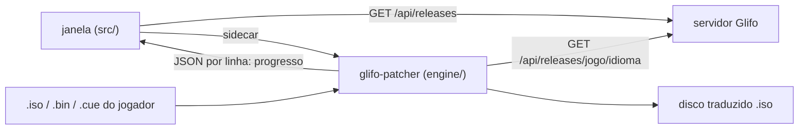

# Glifo — aplicativo para computador

O jogador escolhe o jogo, o idioma e a própria cópia do disco; o app baixa a tradução do servidor do
Glifo e gera um disco novo, traduzido, com uma barra de progresso. O disco original não é alterado e
nada do jogo é enviado para lugar nenhum.



## Peças

| Pasta | O que é |
|---|---|
| `src/` | a interface (HTML/JS puro, sem build). Aberta num navegador comum, roda com um motor de demonstração |
| `src-tauri/` | a janela (Tauri 2). O único código nativo apaga o `.part` quando o usuário cancela |
| `engine/` | o motor em Python, empacotado com PyInstaller (`glifo-patcher.exe` + pasta `glifo-engine/`) e embutido no app como *sidecar* |
| `engine/patchers/` | um módulo por jogo. Hoje: `bml3` (Bomberman Land 3, PS2) |

### Canais

- **Estável**: só as strings com status *revisada* no Glifo.
- **Prévia**: todas as traduções, incluindo rascunhos e textos do Gemini ainda não revisados.

### Publicar um jogo no app

Na aba **Configurações** do projeto, no painel **Aplicativo**, a coordenação escolhe o aplicador do jogo.
A partir daí ele aparece no app para qualquer pessoa, com o progresso de cada idioma. Os dados vêm de
duas rotas públicas e só de leitura:

- `GET /api/releases`: jogos com aplicador, idiomas e progresso.
- `GET /api/releases/:jogo/:idioma?canal=estavel|previa`: o TSV daquele idioma.

### Suporte a outros jogos

Cada jogo é um módulo em `engine/patchers/` com:

- `ID`, `NAME`, `KIND` e `ACCEPT` (as extensões que o jogador pode escolher);
- `detect(caminho)`: confere se é o disco certo e ainda intacto; se não for, levanta `DiscError` com a mensagem para o jogador;
- `apply(origem, tsv, idioma, saída, progress, log, fonts_dir)`: gera o arquivo traduzido.

Para acrescentar um jogo:

1. Registre o módulo em `engine/patchers/__init__.py`.
2. Registre o mesmo `ID` em `PATCHERS`, no `web/server.js`.

Um app antigo que recebe um jogo com aplicador desconhecido mostra o card desativado, com "precisa de
uma versão mais nova do app". O tipo de aplicação (`KIND`: `ps2-iso` hoje; `psp-iso`, `gba-rom`,
`pc-files` no futuro) fica livre para cada módulo.

## Motor (sem a janela)

Dá para usar direto, a partir da raiz do repositório:

```powershell
.venv\Scripts\python desktop\engine\glifo_patcher.py patchers
.venv\Scripts\python desktop\engine\glifo_patcher.py detect --patcher bml3 "Bomberman Land 3 (Japan).cue"
.venv\Scripts\python desktop\engine\glifo_patcher.py apply --patcher bml3 --input "Bomberman Land 3 (Japan).cue" --lang pt --tsv traduzido.tsv --output "BL3 (pt).iso"
```

Sem a extração de 1,6 GB: só as cenas que a tradução toca são descompactadas, numa pasta temporária.
O resultado é idêntico byte a byte ao do `tools/encode.py`. Com a tradução pt completa leva cerca de
2,5 minutos.

## Compilar o app

Requisitos (uma vez só):

- [Rust](https://rustup.rs) e, no Windows, o **Visual Studio Build Tools** com "Desenvolvimento para desktop com C++";
- Node 22 ou mais novo;
- no Python do projeto: `pip install pyinstaller` (além do `requirements.txt`);
- opcional: `NotoSans-Bold.ttf` e `NotoSansCJK-Black.ttc` em `engine/fonts/`, para o app desenhar as letras
  novas sempre com a mesma fonte. Sem elas, usa Arial Bold e Yu Gothic Bold do Windows.

```powershell
cd desktop
npm install
..\.venv\Scripts\python engine\build.py   # gera src-tauri\binaries\glifo-patcher-<alvo>.exe e glifo-engine\ 
npm run dev                                # abre o app em modo de desenvolvimento
npm run build                              # instalador em src-tauri\target\release\bundle\nsis\
```

O motor é empacotado como pasta (`--onedir`), não como arquivo único. No modo arquivo único o PyInstaller
roda um lançador mais um processo filho, e o "Cancelar" (que mata o processo que o app abriu) deixaria o
filho trabalhando. Cada execução grava o próprio PID na sua pasta temporária; `glifo-patcher cleanup`, que o
app chama depois de cancelar, apaga as pastas das execuções que já não estão vivas.

Para mexer só na interface, basta servir `src/` (por exemplo `python -m http.server -d desktop/src`)
e abrir no navegador: sem o Tauri, o app usa jogos e um motor de demonstração.

O endereço do servidor (padrão `https://games.gabirel.dev`) e o idioma do app ficam em **Configurações**.
